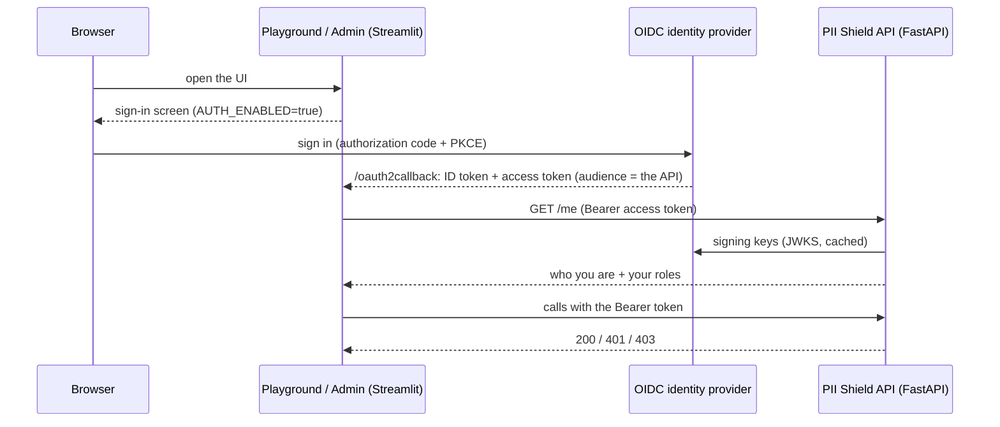

# Authentication and authorization

PII Shield can protect the **API**, the **playground** and the **admin UI** with OpenID Connect (OIDC) sign-in
and role-based access. It is **optional and off by default**: one switch, `AUTH_ENABLED`, controls all three
services, and with it off nothing changes.

- **Standards only.** OIDC authorization-code flow with PKCE for the UIs; OIDC discovery + JWKS and signed JWT
  access tokens for the API. Nothing depends on a particular cloud, gateway or SDK.
- **Any OIDC identity provider (IdP).** Microsoft Entra ID is the primary documented setup. Keycloak is exercised
  end to end by the optional dev profile in this repository. Okta and similar providers should work through
  configuration alone (see [other providers](#other-providers)).
- **Access is granted in the IdP, not in PII Shield.** PII Shield stores no users or permissions; it maps a role
  claim in the access token to `user` or `admin`. Onboarding someone is a role assignment in your IdP: no
  redeploy or restart.



## Contents

1. [Try it locally with Keycloak](#try-it-locally-with-keycloak)
2. [What is protected, and who can do what](#what-is-protected-and-who-can-do-what)
3. [Configuration reference](#configuration-reference)
4. [Identity-provider setup](#identity-provider-setup): [Microsoft Entra ID](#microsoft-entra-id), [other providers](#other-providers)
5. [Granting and revoking access](#granting-and-revoking-access)
6. [Calling the API as a service](#calling-the-api-as-a-service)
7. [Enabling and disabling](#enabling-and-disabling)
8. [Deployment notes](#deployment-notes)
9. [Troubleshooting](#troubleshooting)
10. [Limitations](#limitations)

## Try it locally with Keycloak

The Docker Compose file contains an optional, **development-only** Keycloak (profile `auth-dev`) with a
ready-made realm, so you can see the whole flow without any cloud account.

```bash
cp .env.example .env                              # skip if you already have one
sed -i.bak '/^AUTH_ENABLED=/d' .env && rm .env.bak # the dev settings below set it
cat dev/keycloak/dev.env.example >> .env
docker compose --profile auth-dev up --build
```

The first build takes several minutes. `.env.example` selects `NLP_ENGINE=transformers`, which builds a much larger
image; authentication does not depend on the engine, so for a quicker start set `NLP_ENGINE=spacy` (the Compose
default) in `.env` first. To skip the Grafana container too, name just the services you need:
`docker compose --profile auth-dev up --build redis app playground admin keycloak` (the API then logs harmless
OTLP export errors because there is no collector).

| URL | What |
|---|---|
| http://localhost:7860 | Playground (needs the `PIIShield.User` role) |
| http://localhost:7861 | Admin UI (needs the `PIIShield.Admin` role) |
| http://localhost:8000/docs | API documentation (public) |
| http://localhost:8080 | Keycloak (admin console: `admin` / `admin`) |

| User | Password | Role | Result |
|---|---|---|---|
| `alice` | `alice-dev-password` | `PIIShield.User` | Playground yes; admin UI shows "admin role required" |
| `bob` | `bob-dev-password` | `PIIShield.Admin` | Both UIs |
| `carol` | `carol-dev-password` | none | "Your account does not have access" |

Trying the users by hand:

- **Switching users.** Keycloak keeps one single-sign-on session per browser, so after you sign in as `alice` on one UI,
  clicking *Sign in* on the other UI signs `alice` in silently. To try someone else, click **Sign out** first (it
  ends the Keycloak session too) or use a private window.
- **Short sessions.** Keycloak access tokens last 5 minutes here, so after 5 minutes the UI shows "Your session has
  expired"; **Sign in again** signs you back in without a password while the Keycloak session lives (30 minutes
  idle). Entra ID access tokens typically last an hour or more.
- **Restarts.** Restarting a UI container (`docker compose restart playground`) does not sign anyone out, because the
  session lives in a cookie signed with `AUTH_COOKIE_SECRET`.

Call the API as a service (client-credentials flow):

```bash
TOKEN=$(curl -s http://localhost:8080/realms/pii-shield/protocol/openid-connect/token \
  -d grant_type=client_credentials -d client_id=pii-shield-svc \
  -d client_secret=dev-only-service-client-secret | jq -r .access_token)
curl -H "Authorization: Bearer $TOKEN" http://localhost:8000/apps          # 200
curl http://localhost:8000/apps                                             # 401
```

`scripts/get_token.py` does the same (set `OIDC_ISSUER_URL=http://localhost:8080/realms/pii-shield`,
`OIDC_ALLOW_INSECURE_HTTP=true`, `OIDC_CLIENT_ID` and `OIDC_CLIENT_SECRET`; it needs `pip install requests`) and adds
`--show-claims` for debugging.

The dev service account only has the user role, so admin routes (`/audit-log`, `POST /apps`) answer `403`. To try
them, open the Keycloak console (`admin` / `admin`), realm `pii-shield`, Users,
`service-account-pii-shield-svc`, Role mapping, and assign `PIIShield.Admin`. Tokens you already hold keep their
old roles: request a new one.

Run the authentication tests in the container (no identity provider needed):

```bash
docker compose --env-file /dev/null run --rm --no-deps -T \
  -v "$PWD/app:/app/app" -v "$PWD/tests:/app/tests" -v "$PWD/pii_shield:/app/pii_shield" \
  app sh -c "pip install -q pytest 'redis<6' && python -m pytest -q -p no:cacheprovider \
    tests/test_auth_settings.py tests/test_auth_validator.py tests/test_auth_dependencies.py \
    tests/test_auth_endpoints.py tests/test_ui_launcher.py tests/test_ui_auth.py \
    tests/test_client_tooling.py tests/test_streamlit_auth_deps.py tests/test_audit.py \
    tests/test_env_isolation.py"
```

`--env-file /dev/null` keeps your `.env` out of the test container (for example `.env.example` disables the US
recognizers that some endpoint tests expect). Replace the test list with `tests` to run everything; with the default
spaCy image, 15 NER-dependent tests also fail on `main` and are unrelated to authentication.

To switch authentication off again, set `AUTH_ENABLED=false` (or delete the lines you appended) and run
`docker compose up -d --force-recreate --no-deps app playground admin`.

> **Never reuse** the credentials in `dev/keycloak/`: they are public, and Keycloak runs in development mode
> over plain HTTP. Compose publishes its port on `127.0.0.1` only, so other machines on your network cannot reach
> it; keep it that way, because anyone who could would be able to sign in as an admin.

## What is protected, and who can do what

With `AUTH_ENABLED=true` the API is **default-deny**: every route requires a valid access token unless it is
explicitly public.

| Route | Access |
|---|---|
| `GET /health` | Public (liveness probe, no dependencies) |
| `/docs`, `/redoc`, `/openapi.json` | Public (Swagger has an **Authorize** button for a bearer token) |
| `GET /me` | Any valid token. Returns the caller's identity and effective roles |
| `GET /supported-entities`, `POST /anonymize_unique`, `POST /deanonymize`, `GET /apps`, `GET /apps/{id}` | **User** (admin also allowed) |
| `POST /apps`, `PUT /apps/{id}/config`, `DELETE /apps/{id}`, all `…/allow-list`, `…/entity-type-allow-list`, `…/entity-keyword-allow-list` routes, `GET /audit-log` | **Admin** |

An **admin** is also a user. Role names are configurable (defaults `PIIShield.User` and `PIIShield.Admin`), and
several names may map to one tier, so services can have their own role if you want one.

| Status | Meaning |
|---|---|
| `401` + `WWW-Authenticate: Bearer` | No token, or the token is invalid or expired |
| `403` | Valid token, but it lacks the required role |
| `503` + `Retry-After` | The API cannot obtain the IdP's signing keys, so it cannot verify tokens (it **fails closed**) |

Response bodies are deliberately generic; the specific reason is written to the server log (never the token) and
counted in the `pii.auth.rejections` metric (attributes `reason`, `route`).

The UIs call `GET /me` after sign-in and show a clear screen instead of a broken page when the user is not
signed in, has no access, lacks the admin role, the session expired, or the API is unreachable. The API
enforces the same roles independently, so a UI check is a convenience, not the security boundary.

The audit log records **who** performed each change (`actor`): the user's `preferred_username` (falling back to
name, then subject) or `service:<client id>` for a service. It is empty when authentication is off.

## Configuration reference

All settings are environment variables (see `.env.example`). With `AUTH_ENABLED` off, none of the others are read.
With it on, an invalid configuration **stops the service at startup** with a message listing every problem;
a service never silently runs open. Empty values count as unset.

| Variable | Used by | Default | Notes |
|---|---|---|---|
| `AUTH_ENABLED` | API, UIs | `false` | `true`/`false`/`1`/`0`/`yes`/`no`/`on`/`off`. Anything else is an error. Read at startup: restart all three services after changing it |
| `OIDC_ISSUER_URL` | all | required | Issuer / discovery base (`<issuer>/.well-known/openid-configuration`). Must be `https` unless `OIDC_ALLOW_INSECURE_HTTP=true` |
| `OIDC_AUDIENCE` | API | required | Accepted `aud` value(s), comma-separated |
| `OIDC_ROLES_CLAIM` | API | `roles` | Claim(s) holding roles, comma-separated. Dot-notation for nested claims (`realm_access.roles`). List or space-delimited string values both work |
| `AUTH_USER_ROLES` | API | `PIIShield.User` | Comma-separated role names granting user access |
| `AUTH_ADMIN_ROLES` | API | `PIIShield.Admin` | Comma-separated role names granting admin (and user) access |
| `OIDC_ISSUER` | API | from discovery | Expected `iss` when it differs from the discovery URL (split-horizon DNS, local dev IdP) |
| `OIDC_JWKS_URL` | API | from discovery | Override the signing-key URL |
| `OIDC_ALGORITHMS` | API | `RS256` | Asymmetric algorithms only (`RS*`, `PS*`, `ES*`). `none` and `HS*` are never accepted |
| `OIDC_CLOCK_SKEW_SECONDS` | API | `60` | Leeway for `exp`/`nbf`/`iat` (0-300) |
| `OIDC_JWKS_CACHE_SECONDS` | API | `3600` | Signing-key cache lifetime (60-86400) |
| `OIDC_ALLOW_INSECURE_HTTP` | all | `false` | Permit `http://` IdP URLs. Local development only |
| `OIDC_CLIENT_ID` / `OIDC_CLIENT_SECRET` | UIs | required | The OIDC client the UIs sign in with |
| `OIDC_API_SCOPE` | UIs | empty | Scope that makes the IdP issue the access token **for this API**. Required for Entra (`api://<api-app-id>/access_as_user`) |
| `OIDC_UI_SCOPES` | UIs | `openid profile email` | Space- or comma-separated (use commas in a `.env` file). `OIDC_API_SCOPE` is appended |
| `OIDC_SERVER_METADATA_URL` | UIs | from issuer | Override the discovery document URL |
| `OIDC_PROMPT` | UIs | unset | Sign-in prompt behaviour (Streamlit defaults to `select_account`) |
| `AUTH_COOKIE_SECRET` | UIs | required | Signs the UI session cookie: at least 32 characters, identical on every replica. `python -c "import secrets; print(secrets.token_urlsafe(48))"` |
| `UI_REDIRECT_URI` | UIs | `http://localhost:{port}/oauth2callback` | One value per UI container; must end in `/oauth2callback` and be `https` unless localhost. In Compose it is set from `PLAYGROUND_REDIRECT_URI` / `ADMIN_REDIRECT_URI` |

How the UIs get their configuration: Streamlit reads OIDC settings only from `.streamlit/secrets.toml`, so the UIs
are started through `python -m app.ui_launcher {playground|admin}`. It validates the settings, writes that file
from the environment (mode `0600`, regenerated on every start, ignored by Git and Docker builds) and then starts
Streamlit with the same flags as before. With authentication off it generates nothing. Compose, the Azure
definitions and `scripts/run_local_nodocker.sh` all use it. If you run `streamlit run` by hand with
authentication enabled, the UI tells you the OIDC configuration is missing.

## Identity-provider setup

PII Shield needs three things from an IdP:

1. A **client for the UIs** (confidential, authorization-code flow, PKCE) with redirect URIs
   `https://<playground-host>/oauth2callback` and `https://<admin-host>/oauth2callback` (also register them as
   post-logout redirect URIs).
2. **Access tokens issued for the API**: audience = `OIDC_AUDIENCE`, a role claim carrying
   `AUTH_USER_ROLES` / `AUTH_ADMIN_ROLES`, `iss` equal to the issuer, signed with an asymmetric key published at
   the JWKS endpoint.
3. A way to **assign roles** to users, groups and service clients.

### Microsoft Entra ID

> Verified end to end against a real Microsoft Entra tenant on Azure Container Apps: scripted setup, user and
> service tokens, role enforcement, the sign-in outcomes below (user, admin, unrecognised role, unassigned) and
> `AUTH_ENABLED` flipped off and on again. The automated test suite still uses Keycloak, because there is no Entra
> tenant in CI. Follow these steps in a non-production tenant first.

**Scripted setup.** In a test or demo tenant, `infra/scripts/07-setup-entra.sh create` does all of the steps below
for you (and creates test users and test services); `delete` removes them again. It needs the Container Apps
environment to exist (the redirect URIs contain its default domain), is safe to re-run, and writes the resulting
`OIDC_*` values and the test credentials to a private file outside the repository
(`~/.config/pii-shield/<project>.entra.env`, mode 0600). Load it with `set -a; . <file>; set +a` and run
`06-configure-auth.sh enable`.

You can use **one** app registration that acts as both the API and the UI client (simplest), or two. The steps
below use one; with two, put the API settings on the API registration and the client settings on the client
registration.

1. **Register the application** (Microsoft Entra ID, App registrations, New registration). Single tenant.
   Note the **Application (client) ID** and **Directory (tenant) ID**.
2. **Expose the API.** *Expose an API*: set the Application ID URI (`api://<client-id>`) and add a scope
   `access_as_user` (admins and users can consent).
3. **Use v2 access tokens.** In the manifest, set the requested/accepted access-token version to `2`
   (`api.requestedAccessTokenVersion: 2` in the Microsoft Graph manifest, `accessTokenAcceptedVersion: 2` in the
   legacy one). v2 tokens carry `iss = https://login.microsoftonline.com/<tenant-id>/v2.0` and
   `aud = <client-id>`, which is what the defaults expect.
   (To stay on v1 tokens instead, set `OIDC_ISSUER=https://sts.windows.net/<tenant-id>/` and
   `OIDC_AUDIENCE=api://<client-id>`.)
4. **Define app roles.** *App roles*: create `PIIShield.User` and `PIIShield.Admin` (value = the role name).
   Allowed member types: **Users/Groups**, and also **Applications** if services should hold them.
5. **Sign-in client settings.** *Authentication*: add a **Web** platform with both redirect URIs. *Certificates &
   secrets*: create a client secret (store it in your secret manager). *API permissions*: add your own
   `access_as_user` delegated permission and grant consent.
6. **Require assignment.** *Enterprise applications*, your app, *Properties*: **Assignment required = Yes**, so
   unassigned users and apps cannot obtain tokens at all.
7. **Assign access.** *Enterprise applications*, your app, *Users and groups*: assign users or groups to
   `PIIShield.User` / `PIIShield.Admin`. Prefer app roles over group claims (Entra drops group claims from tokens
   for users in very many groups).
8. **Configure PII Shield.**

```dotenv
AUTH_ENABLED=true
OIDC_ISSUER_URL=https://login.microsoftonline.com/<tenant-id>/v2.0
OIDC_AUDIENCE=<client-id>
OIDC_ROLES_CLAIM=roles
OIDC_CLIENT_ID=<client-id>
OIDC_CLIENT_SECRET=<client-secret>
OIDC_API_SCOPE=api://<client-id>/access_as_user
AUTH_COOKIE_SECRET=<random, 32+ characters>
```

**Services.** Give each calling service its own app registration and secret. On *your* API registration it needs
an **application permission** for a role (API permissions, Add a permission, My APIs, Application permissions),
with **admin consent**. It then requests a token for `api://<client-id>/.default`:

```bash
OIDC_ISSUER_URL=https://login.microsoftonline.com/<tenant-id>/v2.0 \
OIDC_CLIENT_ID=<service-client-id> OIDC_CLIENT_SECRET=... \
OIDC_SCOPE=api://<client-id>/.default \
  python scripts/get_token.py
```

### Other providers

- **Keycloak.** See `dev/keycloak/pii-shield-realm.json`: realm roles `PIIShield.User` / `PIIShield.Admin`, a
  confidential client for the UIs, an **audience mapper** adding `pii-shield-api` to access tokens, and a
  client-credentials client for services. Roles arrive in `realm_access.roles`, so set
  `OIDC_ROLES_CLAIM=realm_access.roles`. If browsers and containers reach Keycloak under different host names
  (as in Compose), set Keycloak's hostname so tokens carry the browser-facing issuer and tell the API what to
  expect with `OIDC_ISSUER`, as `dev/keycloak/dev.env.example` does.
- **Okta** (custom authorization server) and similar OIDC providers: set `OIDC_ISSUER_URL` to the authorization
  server's issuer, `OIDC_AUDIENCE` to its audience, and `OIDC_ROLES_CLAIM` to the claim that carries roles
  (for example a `groups` claim, with `AUTH_USER_ROLES` / `AUTH_ADMIN_ROLES` set to the group names). *Untested.*
- **Auth0** needs an `audience` parameter on the authorization request, which Streamlit's OIDC configuration
  cannot add. It may work if you set the tenant-wide *Default Audience* to your API identifier. *Untested.*

## Granting and revoking access

| Who | Grant | PII Shield change |
|---|---|---|
| New user | Assign the user (or a group) to the user or admin role in the IdP | None |
| New service | Give it its own client and credential; assign it a role (Entra: application permission + admin consent); it fetches a client-credentials token | None |

- A token **must carry a configured role**; a valid token without one gets `403`. Role changes appear in the
  *next* token, so users sign out and in again to pick up a new role.
- **Revoking.** Remove the assignment or disable the client. Tokens already issued keep working until they
  expire (typically 5-90 minutes, set in the IdP), so keep access-token lifetimes short.
- Only admins can register applications (`POST /apps`), so an admin creates the `X-App-Id` for a team in the Admin UI.
- `X-App-Id` is unchanged and is **not** an authentication mechanism: any caller with the user role can use any
  registered app id. See [limitations](#limitations).

## Calling the API as a service

Use the client-credentials flow and send the token on every request:

```bash
export API_ACCESS_TOKEN="$(python scripts/get_token.py)"
curl -H "Authorization: Bearer $API_ACCESS_TOKEN" -H "X-App-Id: <app id>" \
     -H "Content-Type: application/json" -d '{"text": "..."}' https://<api-host>/anonymize_unique
```

`scripts/get_token.py` finds the token endpoint by OIDC discovery, prints only the token on stdout, refuses plain
`http://` unless `OIDC_ALLOW_INSECURE_HTTP=true`, and has `--show-claims` to print what the token says
(audience, issuer, roles, expiry; unverified) when you are debugging a `401`/`403`. Tokens expire: fetch a new
one before they do (most client libraries can do this for you).

The bundled test tools accept the same token: `examples/run_indian_banking_tests.py`,
`examples/run_indian_banking_tests_azure.py`, `examples/scale_test.py` and `scripts/cleanup_test_apps.py` read
`API_ACCESS_TOKEN` (or `--access-token`). They also need an admin-role token because they register applications.
The two `run_indian_banking_tests*.py` runners ask the API who the token belongs to (`GET /me`) before the first
test and stop with a clear message when the token is missing, rejected or not an admin's, instead of running a
suite in which every test fails. A full run takes a few minutes, so a token fetched just before it is enough.

## Enabling and disabling

**Docker Compose / local.** Set `AUTH_ENABLED` and the `OIDC_*` values in `.env`, then recreate the services
(`docker compose up -d --force-recreate --no-deps app playground admin`). `scripts/run_local_nodocker.sh` generates
and saves an `AUTH_COOKIE_SECRET` for you when authentication is enabled and none is set.

**Azure Container Apps.**

```bash
# first deployment
AUTH_ENABLED=true OIDC_ISSUER_URL=... OIDC_AUDIENCE=... OIDC_CLIENT_ID=... \
OIDC_CLIENT_SECRET=... AUTH_COOKIE_SECRET=... ./infra/scripts/02-deploy-apps.sh

# flip an existing deployment (no image rebuild)
OIDC_ISSUER_URL=... OIDC_AUDIENCE=... OIDC_CLIENT_ID=... OIDC_CLIENT_SECRET=... AUTH_COOKIE_SECRET=... \
  ./infra/scripts/06-configure-auth.sh enable
./infra/scripts/06-configure-auth.sh disable

# check it
AUTH_ENABLED=true VERIFY_ACCESS_TOKEN="$(python scripts/get_token.py)" ./infra/scripts/03-verify.sh
```

Secrets are passed from your environment into Container Apps secrets, not committed. `06-configure-auth.sh`
changes the UIs first when enabling and the API first when disabling, so every intermediate state is usable, and
requires UI apps that already run the launcher (it tells you if they do not; redeploy them once with
`02-deploy-apps.sh`). It then waits until the new revisions are serving (`ROLLOUT_TIMEOUT_SECONDS`, default 600),
so `03-verify.sh` can follow immediately: `az containerapp update` alone returns while the previous revision
still answers for a couple of minutes.

`01-build-push.sh` and `02-deploy-apps.sh` read their targets (resource group, registry, environment, Redis) from
`terraform output`, so Terraform must be installed and initialised against the remote state first
(`terraform init` with the `-backend-config` flags printed by `00-bootstrap-state.sh`; see `infra/README.md`).
Azure Cloud Shell already has Terraform and the Azure CLI. `03-verify.sh` and `06-configure-auth.sh` need only
`RG_NAME` (and the app names, if you changed them) plus the Azure CLI.

**Recommended rollout**

1. Deploy the new version with authentication **off** (nothing changes; `/health` and `/me` appear).
2. Configure the IdP (roles, client, redirect URIs, assignment required).
3. Onboard calling services **before** enabling: once on, requests without a token get `401`.
4. Enable in a non-production environment and run `03-verify.sh`; then enable in production.
5. **Rollback** is `AUTH_ENABLED=false` on all three services.

## Deployment notes

- **UIs run as a single replica when authentication is on.** Streamlit keeps its sign-in state in process memory,
  so the redirect to the IdP and the callback must reach the same process
  ([streamlit/streamlit#13773](https://github.com/streamlit/streamlit/issues/13773)). The Azure scripts set
  `maxReplicas: 1` for both UIs. To scale out, enable session affinity on your ingress and keep
  `AUTH_COOKIE_SECRET` identical on every replica.
- **Restarts and scale-to-zero.** The UI session lives in a signed cookie, so people who are already signed in stay
  signed in when a UI replica restarts or scales to zero (the Azure scripts allow scale-to-zero). A restart *during*
  the redirect to the IdP loses that one pending login: the user sees the sign-in screen again and signs in a
  second time. The first visit after an idle period waits for a cold start (tens of seconds for a UI, longer for
  the API, which loads the NER model) and the browser may show a connection error once; reload, or keep one
  replica warm (see `DEPLOYMENT.md`).
- **Sign out.** The UI ends its own session, then Streamlit sends the browser to the IdP's end-session endpoint.
  Entra shows an account chooser there; choosing the account completes the sign-out and returns to the sign-in
  screen through the registered redirect URI.
- **Sessions and expiry.** Streamlit does not refresh tokens. When the access token expires the UI shows "Your
  session has expired" and offers to sign in again (one click while the IdP session is alive; the user may see
  an account chooser). The Streamlit cookie itself lasts up to 30 days, independent of token lifetime.
- **Redirect URIs** must match exactly what you registered at the IdP, scheme and host included, and must be
  `https` outside localhost. Register the same URLs for post-logout redirects.
- **Traffic between the UIs and the API carries the user's bearer token.** In the Azure setup it stays on the
  Container Apps environment network (`API_BASE=http://<api app>`). If your threat model needs it, enable
  internal TLS or point `API_BASE` at the API's HTTPS address.
- **The API needs outbound access to the IdP's discovery and JWKS endpoints** (cached; refreshes are throttled).
  If keys cannot be fetched and none are cached, requests get `503` rather than being let through. Cached keys keep
  working through short IdP outages.
- **Secrets.** Provide `OIDC_CLIENT_SECRET` and `AUTH_COOKIE_SECRET` through your platform's secret store or CI
  secrets. The generated `.streamlit/secrets.toml` is `0600`, regenerated on start, ignored by Git and excluded
  from Docker images.
- **No tokens in logs or metrics.** Rejections log only a reason and the route.
- The legacy Gradio UIs (`app/gradio_*.py`) have no sign-in support and are not covered.

## Troubleshooting

The API logs `Auth rejected (<reason>, HTTP <status>) on <route>`. Decode the token you sent with
`python scripts/get_token.py --show-claims` (or any JWT viewer) and compare it with the settings.

| Symptom / log reason | Likely cause | Fix |
|---|---|---|
| Service will not start: `Invalid authentication configuration` | A required `OIDC_*` / `AUTH_*` value is missing or invalid | Fix the listed items; the message names every problem |
| `401` `missing_token` | No `Authorization: Bearer ...` header | Send the token; for UIs, sign in |
| `401` `bad_audience` | Token `aud` is not in `OIDC_AUDIENCE` | Check `--show-claims`; for Entra use `OIDC_API_SCOPE` and v2 tokens |
| `401` `bad_issuer` | Token `iss` differs from the expected issuer | Entra v1 vs v2 tokens; or set `OIDC_ISSUER` |
| `401` `expired` / `not_yet_valid` | Token expired, or clocks differ by more than `OIDC_CLOCK_SKEW_SECONDS` | Fetch a new token; sync clocks |
| `401` `unknown_kid` / `bad_signature` | Signed by a key the API does not know | Right issuer/tenant? Wait for the key refresh (30 s throttle) |
| `401` `alg_not_allowed` | Token algorithm is not in `OIDC_ALGORITHMS` | Use RS256 or list the algorithm |
| `403` `insufficient_role` | Token has no configured role for this route | Assign the role; check `OIDC_ROLES_CLAIM` and role names; sign in again |
| `503`, log `Signing-key refresh failed` | Cannot reach the IdP's discovery/JWKS | Network egress, DNS, `OIDC_ISSUER_URL` |
| Log `discovery issuer ... does not match OIDC_ISSUER_URL` | The IdP announces a different issuer | Use the exact issuer, or set `OIDC_ISSUER` |
| UI: "Authentication is enabled but Streamlit's OIDC configuration is missing" | UI was not started through `python -m app.ui_launcher` | Start it through the launcher |
| UI: "no API access token is available" | The IdP did not issue an access token | Check `OIDC_API_SCOPE` and the client's API permissions |
| UI: signed in but "does not have access" | Account has no role | Assign a role, then sign out and in |
| Sign-in loops back to the sign-in screen | Callback reached a different replica, or the redirect URI differs | Run one replica (or session affinity); match the redirect URI exactly |
| IdP error about the redirect URI (Entra `AADSTS50011`) | URI not registered | Register `https://<host>/oauth2callback` exactly |
| Entra `AADSTS50105`: the signed-in user is not assigned to a role | *Assignment required* is on and the user (or their group) has no assignment | Assign the user or group to a role (step 7); this is the intended block for unassigned accounts |
| Entra sign-in stops at "Let's keep your account secure" | The tenant enforces MFA registration (for example Security Defaults) for new accounts | The user registers an authenticator at first sign-in. To automate it for test users, choose "Set up a different authentication app" and "Can't scan the QR code?" to reveal a TOTP secret, then answer the code prompt on later sign-ins |

## Limitations

- **Authorization is role-based only.** There are two tiers (user, admin). Any user-tier caller can use any
  registered `X-App-Id`; binding IdP clients to specific applications (so one team cannot use another's
  configuration) is not implemented.
- **Revocation is bounded by token lifetime.** The API validates self-contained tokens and does not call the IdP
  per request.
- **`/docs` is public.** It exposes the API schema, not data.
- Streamlit, not PII Shield, implements the UI sign-in flow; its limits (no token refresh, in-process state)
  apply.
- Mutual TLS and API keys are not part of this change.
